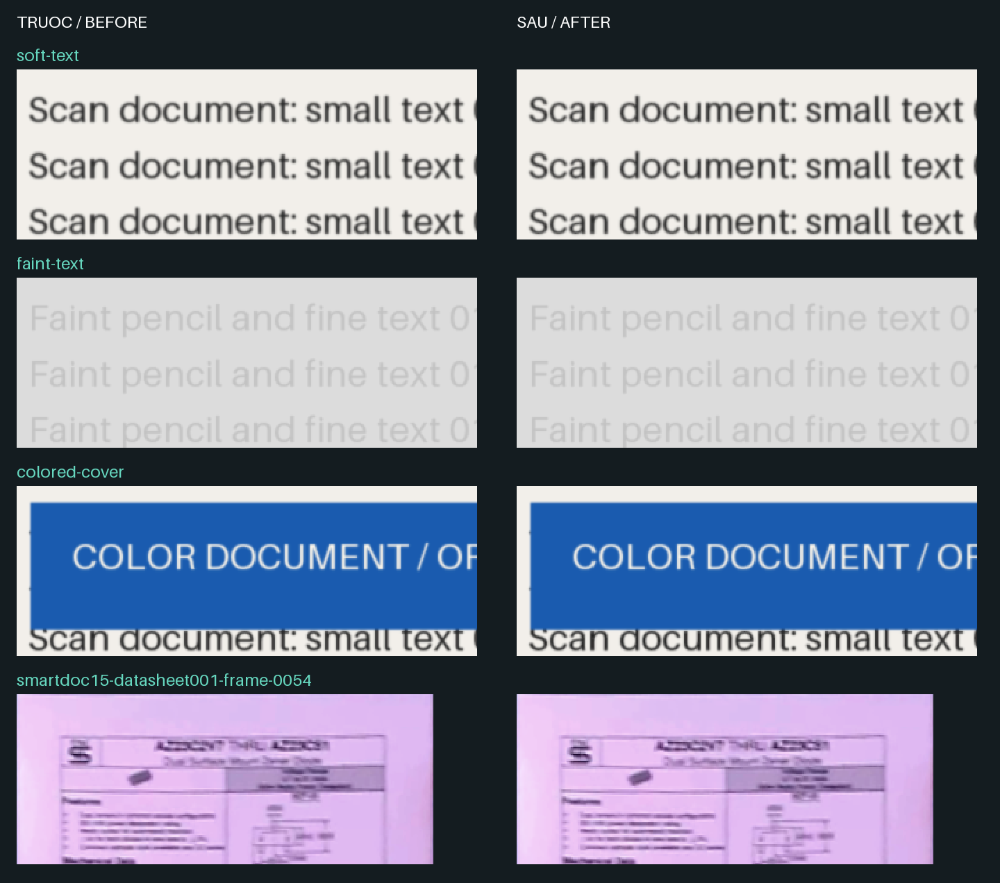

# Enhanced color v2 — 2026-10-24

The default Enhanced preset now combines the existing shared RGB contrast curve with conservative ink-edge detail. It does not change output resolution, JPEG quality, PDF embedding or corner detection. Auto, grayscale and black/white retain their existing adaptive restoration path; Original retains its pixels before encoding.

Detail uses three luminance rows (at most 9,000 additional bytes at 3,000px width), not a full-frame copy or a new model. It darkens coherent, moderately soft ink edges by at most 12 levels, applies the same delta to RGB, avoids new clipped channels and bright paper halos, and skips isolated specks, crisp edges, periodic textures and transparent neighborhoods. Flat rows are skipped. This is a modest clarity improvement, not deblurring or reconstruction of missing text.

Enhanced now measures its final-resolution pixels rather than a 720px resampling. Both web and native use the same rules. Web Enhanced/Original skip the unused classifier and analysis warp; classifier startup is lazy when choosing Auto/gray/black-white. Consequently these two presets report local processing and do not provide classifier-based finger/curve/blur warnings. Choose Auto when those diagnostics/adaptive restoration are needed. Native Enhanced already skipped classification and now also avoids its reduced analysis warp. Existing cached Auto analysis may be retained for subsequent edits but does not control Enhanced appearance.

## Validation

- 19 isolated-kernel comparisons: four deterministic synthetic samples and 15 licensed SmartDoc frames, with the same final crop passed to old/new filters. 18 changed; the paper-noise sample was unchanged. No new clipped channels, brightened channels or changed RGB channel differences relative to the old curve on this set.
- Horizontal-gradient totals increased 2.91% for synthetic soft text and 2.48% for the synthetic color page. Faint pencil improved only slightly (0.12%); this is not an OCR accuracy score or a universal perceptual metric.
- C++: 23 raw pixel parity cases, including soft/color/faint ink and noise, match web goldens (maximum allowed difference 1, mean ≤0.05). Old native binary failed the updated parity set before rebuilding. All 5 native CTest suites passed, including ABI/runtime and independent integration.
- Web regressions cover flat surfaces, alpha, faint marks, color preservation, noise, already crisp ink, periodic detail, classifier-free presets, adaptive Auto analysis and camera re-entry. Production-mode browser smoke passes import → filter edit → Add → Capture → Finish. Physical Android/iPhone quality, heat and power remain unmeasured.

## Desktop timing

| Measurement | Before | After |
| --- | ---: | ---: |
| Web production, warm capture pipeline | 437.70 ms | 392.65 ms |
| Native, 12MP source → 3000×2250, JPEG + PDF | 253.85 ms | 256.92 ms |
| Native, 48MP source → 3000×2250, JPEG + PDF | 558.66 ms | 596.98 ms |

Web: both production builds in Chrome on this Windows x64 desktop, nine synthetic 2400×3200 captures; medians of the last six pages, startup excluded. Analysis/classifier results were present on all six baseline pages and none of the six candidate pages. Native: old/new DLLs alternated in one process, six runs per version/size, median excluding the first; full-frame crop, Enhanced, JPEG96/4:4:4 and PDF, without corner inference or model startup. These are different workloads; do not use the table as a JS-vs-C++ speed comparison. Native clarity costs about 3ms/38ms overall on these two cases (+1.2%/+6.9%). Results include codec/output differences and normal measurement variation; no claim of exact peak RAM or phone performance.

Raw observations and provenance: [enhanced-color-v2.json](enhanced-color-v2.json). Baseline web source: `0fd0803904d6c6b070f902af7b3b9a53998a38dc`. The isolated-kernel baseline bundle is retained locally at `.tmp-quality/baseline-pixels.mjs`; native baseline DLL/source backups are in `.tmp-quality/baseline-native/`.

## Reproduce

Run `python scripts/prepare-quality-samples.py` (test-only Pillow), then `node scripts/benchmark-enhanced-quality.mjs <frozen-baseline-module>`. The baseline module exports `applyDocumentFilter`, `analyzeDocumentQuality` and `warpPerspectiveRgba` from the previous revision; bundle it with the repository's esbuild. Run both filters on the same generated RGBA files. No OCR service or image upload is involved.

For production browser QA: `npx vite build --config tests/browser/vite.quality.config.ts`, copy the existing `tests/fixtures/synthetic/flat-document.png` into that build's `tests/fixtures/synthetic/` for the App smoke, then serve `test-results/quality-dist` with Vite preview. Use `scripts/run-browser-benchmark.mjs` with its pipeline/App HTML URL; append `?fallback` to the App URL for the DOM detector. The local development module server was unsuitable for this timing run because module loading stalled; production builds completed the checks. Do not use disabled production internal timing fields as zero-cost measurements: `processingMs` is measured outside `enqueue`.

SmartDoc fixture attribution: ICDAR2015 SmartDoc Challenge 1; Burie, Chazalon, Coustaty, Eskenazi, Luqman, Mehri, Nayef, Ogier, Prum and Rusinol. Dataset [10.5281/zenodo.1230218](https://zenodo.org/records/1230218), [CC BY 4.0](https://creativecommons.org/licenses/by/4.0/). Original attribution and privacy metadata remain in each fixture manifest. Synthetic samples use Pillow's default font and contain no user documents.
