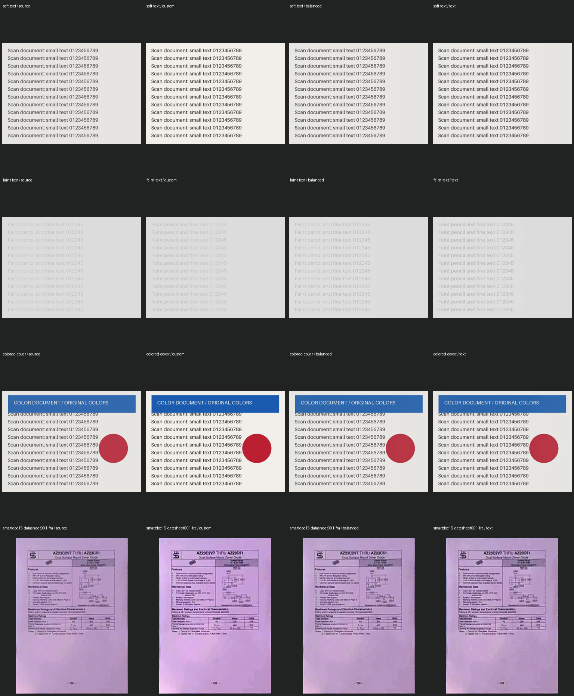

# OpenCV candidate v1 — 2026-10-24

This compares actual custom C++ and OpenCV raster kernels, not a reconstruction
of CamScanner. Both are built into the same v2 WASM. Shared crop annotations and
output sizing precede the enhanced filter; each profile is compared to its own
Original warp for enhancement-only metrics. Source in the contact sheet is the
OpenCV Original warp. OpenCV uses linear interpolation tables, so skewed raw
pixels need not equal the custom sampler.

Inputs: four deterministic synthetic samples and 15 SmartDoc frames, with the
same annotated document corners (synthetic inputs use full frame). 76 profile
cases passed dimensions and no-new-clipped-channel checks. Faint text shows
increased edge contrast with OpenCV; custom color/soft-text results have stronger
contrast than conservative OpenCV. Preserve both until user evaluation. No OCR
ground truth, perception score or universal quality ranking is implied.

[Raw kernel observations](opencv-v1.json) include WASM SHA-256. Timings are single
observations including input/output copies, without repetitions, randomized
order or confidence intervals. They are not a speed leaderboard or an estimate
of native DLL/phone performance. Horizontal luminance gradient excludes row
boundaries, but remains sensitive to noise. Pixel changes are not OCR accuracy.

[One production browser 48MP run](opencv-browser-48mp.json) records common decode,
warp+filter, PNG and reserved WASM memory separately. Its settings are OpenCV
Rõ chữ, full crop, Enhanced, 1 run each, Chromium on Windows x64. No phone heat,
CPU, peak process RAM or battery energy was measured. UI frame gaps describe
responsiveness only. The deployment used the same WASM hash as these samples.

Reproduce with the commands in [implementation notes](../opencv-comparison.md).
Original synthetic generation and SmartDoc preparation are unchanged.

SmartDoc attribution: ICDAR2015 SmartDoc Challenge 1; Burie, Chazalon, Coustaty,
Eskenazi, Luqman, Mehri, Nayef, Ogier, Prum and Rusinol. Dataset
[10.5281/zenodo.1230218](https://zenodo.org/records/1230218),
[CC BY 4.0](https://creativecommons.org/licenses/by/4.0/). Original fixture
attribution remains in each manifest. These samples contain no user documents.
