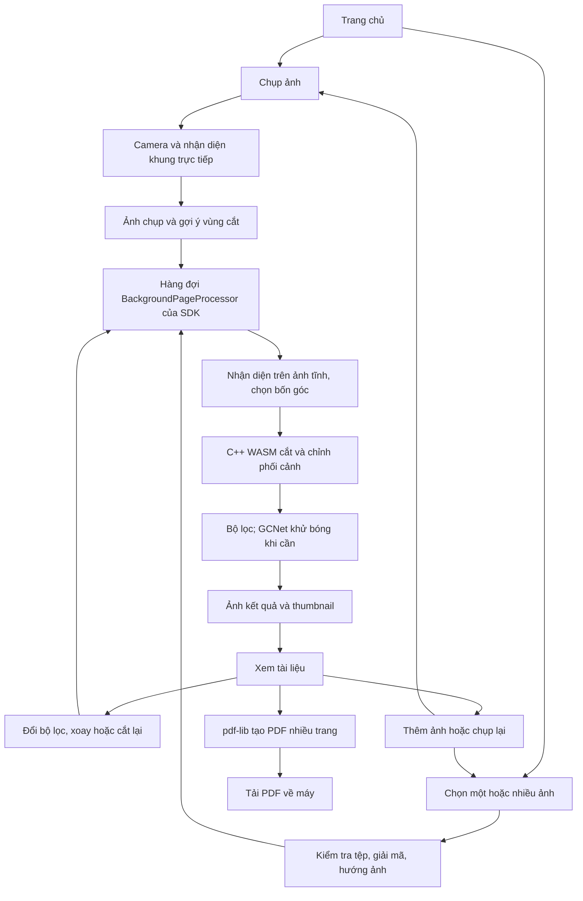

# Luồng xử lý hiện tại — 27/10/2026

Tài liệu mô tả mã hiện tại sau bản sửa vòng đời bộ xử lý v18. Các báo cáo thử nghiệm trước ngày này là lịch sử, không phải mô tả mặc định của web.

## 1. Tổng thể

Web chính hiện dùng `@docscan/browser`. SDK được đóng gói từ `../thuvien/browser`; lõi xử lý pixel được biên dịch từ C++ sang WebAssembly. Trình duyệt không nạp `docscan.dll` của Windows và không gửi ảnh lên máy chủ để xử lý.

## 2. Chụp ảnh

1. React mở màn hình camera. Camera service gọi API camera của trình duyệt, chủ yếu là `getUserMedia`; khả năng chọn camera, lấy nét và phơi sáng phụ thuộc thiết bị/trình duyệt.
2. Phiên nhận diện trực tiếp lấy các khung hình nhỏ, dùng Scanic/DocCornerNet qua ONNX Runtime để ước lượng bốn góc. Tensor nhận diện là **224 × 224**. Bộ lập lịch không gửi thêm khung khi lượt trước chưa xong; kết quả được làm ổn định trước khi vẽ lên video.
3. Khi bấm chụp, phần thu ảnh ưu tiên khả năng chụp của thiết bị khi có; nếu không thì lấy khung video. Ảnh chụp và gợi ý vùng cắt được đưa vào hàng đợi xử lý trang.
4. Nhận diện trực tiếp chỉ giúp căn khung. Phần xử lý ảnh tĩnh có thể nhận diện lại trên ảnh chụp để chọn vùng cắt tốt hơn. Không đủ tin cậy thì giữ toàn ảnh và cho người dùng chỉnh bốn góc.
5. Bấm Xong chuyển sang xem các trang. Thoát camera phải dừng lấy mẫu, giải phóng phiên nhận diện và camera stream. Khi mở lại camera, ứng dụng phối hợp với hàng đợi xử lý để không giữ phiên cũ ngoài ý muốn.

Phiên nhận diện video và phiên xử lý trang có thể cùng tồn tại khi người dùng chụp nhiều trang. Chúng phục vụ hai công việc khác nhau; không phải mọi thao tác trong ứng dụng chỉ có đúng một worker.

## 3. Dùng ảnh có sẵn

1. Có thể chọn nhiều ảnh; giao diện giới hạn số lượng mỗi đợt để không nạp không giới hạn vào RAM.
2. SDK kiểm tra loại ảnh, kích thước, số pixel và hướng ảnh. Các giới hạn bảo vệ bộ nhớ vẫn tồn tại; không phải mọi định dạng/độ lớn đều được hỗ trợ vô hạn.
3. Trình duyệt giải mã bằng codec sẵn có khi được hỗ trợ. HEIC/HEIF có nhánh dự phòng bằng worker và `heic-to/libheif`; nhánh này vẫn cần tệp decoder CSP trong `public/vendor/heif/` do web cung cấp.
4. SDK giữ ảnh nguồn dùng cho chỉnh sửa sau này, tạo ảnh nhỏ phục vụ nhận diện/hiển thị, rồi đưa từng ảnh vào **cùng hàng đợi** với ảnh camera.

## 4. Hàng đợi chung và nhận diện ảnh tĩnh

`BackgroundPageProcessor.enqueue()` phụ trách nhập ảnh mới; `BackgroundPageProcessor.render()` phụ trách chỉnh lại trang. Hai hàm dùng chung hàng đợi và phiên render.

1. Trang chuyển qua các trạng thái chờ → đang xử lý → sẵn sàng hoặc lỗi.
2. SDK chuẩn bị khung nhận diện ảnh tĩnh, mặc định cạnh dài tối đa **960 px**. DocCornerNet vẫn nhận tensor 224 × 224; bốn góc được đổi về hệ tọa độ ảnh nguồn.
3. Vùng cắt người dùng đã chọn được giữ trong công thức chỉnh sửa (`EditRecipe`), cùng bộ lọc và góc xoay. Không chạy nhận diện lại để tự thay vùng cắt thủ công ở mỗi lần đổi bộ lọc.
4. Ảnh nhỏ nhận diện không phải ảnh đầu ra. Ảnh nguồn vẫn dùng cho bước lấy mẫu/cắt ở độ phân giải xuất.

## 5. Cắt, phối cảnh, bộ lọc và khử bóng

| Bước | Thành phần thực hiện | Công việc |
| --- | --- | --- |
| Đọc vùng ảnh nguồn | Codec/canvas trong SDK | Đọc từng vùng có giới hạn kích thước; tránh sao chép cả ảnh RGBA lớn sang WASM nhiều lần. |
| Cắt và phối cảnh | Lõi C++ → WASM | Kiểm tra tứ giác, dựng phép biến đổi, lấy mẫu ảnh để đưa bốn góc về hình chữ nhật. |
| Phân tích tăng cường | Lõi C++ | Ước lượng nền, chữ, màu và mức cần bù bóng; hạn chế làm sáng nhầm vùng màu tối. |
| Bù bóng bằng model | GCNet + ONNX Runtime trong SDK | Khi chính sách yêu cầu, suy luận bản đồ chiếu sáng trên ảnh nhỏ, cạnh tối đa **384 px**. |
| Áp dụng bản đồ và hoàn thiện | Lõi C++ → WASM | Đưa hiệu chỉnh về ảnh xuất, xử lý tương phản/màu và tăng rõ chữ theo chế độ. |
| Xoay, mã hóa, thumbnail | C++ và codec của SDK | Xoay theo công thức, mã hóa ảnh cuối và tạo thumbnail. |

Ảnh đầu ra của luồng web hiện có cạnh dài tối đa **3000 px**, giữ tỷ lệ, không mặc định phóng lớn ảnh nhỏ. Bản đồ model nhỏ không thay ảnh nguồn bằng ảnh 384 px. Sau lần đọc vùng cuối, SDK đóng bitmap/reset canvas nguồn và giải phóng vùng đệm trung gian trước khi GCNet cấp phát bộ nhớ suy luận.

| Chế độ | Luồng hiện tại |
| --- | --- |
| Gốc | Cắt/phối cảnh/xoay; không áp dụng tăng cường hoặc khử bóng. |
| Tăng cường — mặc định | Tăng cường thích ứng bằng C++; gọi GCNet khi chính sách thấy cần. Không có nghĩa ảnh nào cũng chạy model. |
| Khử bóng AI | Yêu cầu khử bóng bằng model. Lỗi được báo, không giả là đã khử bóng thành công. |
| Tự động, Xám, Đen trắng | Có nhánh phân tích khuyết điểm tài liệu bằng classifier để lập kế hoạch xử lý, rồi render theo bộ lọc. Bản cắt phân tích tối đa 720 px tách khỏi ảnh cuối. |

Nếu Tăng cường không chạy được model, có thể giữ bản tăng cường nhẹ **kèm cảnh báo**. Nếu thao tác chỉnh sửa thất bại, giao diện giữ trang trước. Model không bảo đảm xoá hết mọi bóng, phản sáng hoặc khôi phục phần chữ đã mất trong ảnh gốc. Chỉnh phối cảnh bốn góc cũng không đồng nghĩa trải phẳng hoàn toàn mọi dạng giấy cong.

## 6. Đổi chế độ, xoay, cắt lại, thêm và xoá trang

- Đổi bộ lọc, xoay, cắt lại: UI cập nhật công thức → gọi `pageProcessor.render()` → hàng đợi chung render lại từ nguồn. Không liên tục chỉnh trên JPEG kết quả của lần trước.
- Thêm: mở camera hoặc chọn ảnh rồi quay lại `enqueue()` như ban đầu; kết quả mới được thêm vào tập trang.
- Chụp lại: thay nguồn của trang được chọn và xử lý lại; kết quả cũ chỉ được thay khi có kết quả mới hợp lệ.
- Xoá trang/huỷ thao tác/rời luồng: huỷ công việc liên quan và giải phóng tài nguyên thuộc quyền sở hữu của phiên đó.
- Phiên render đã lỗi được loại bỏ; công việc sau có thể khởi tạo phiên mới, thay vì tiếp tục dùng engine hỏng.

## 7. “Bộ xử lý riêng” trong lỗi vừa sửa là gì?

Một **engine instance** là một đối tượng đang chạy trong RAM, có thể giữ worker, model đã nạp và heap WASM. Đây không phải một bản sao thư mục mã nguồn.

Trước bản sửa v18, nhập ảnh dùng phiên A nhưng một số thao tác sửa trang lại tạo phiên B. Hai phiên có thể giữ tài nguyên cùng lúc; một phiên lỗi còn có thể bị giữ lại cho các thao tác tiếp theo. Bản sửa cho **nhập ảnh và chỉnh trang dùng cùng hàng đợi/phiên xử lý ảnh cuối**, đồng thời bỏ phiên hỏng để có thể khởi tạo lại.

Phiên nhận diện camera trực tiếp vẫn riêng vì phải đọc video liên tục. ONNX Runtime/model cũng có tài nguyên nội bộ riêng. Dùng một thư viện không có nghĩa mọi model và mọi tác vụ chia sẻ duy nhất một vùng RAM.

## 8. Xuất PDF và lưu tài liệu

SDK nhận các ảnh kết quả đã sẵn sàng, dùng `pdf-lib` nhúng từng ảnh theo thứ tự trang, giữ tỷ lệ và tính kích thước trang theo quy ước 300 PPI. Đây là **PDF chứa ảnh**, chưa có lớp chữ OCR. UI tạo liên kết tải Blob về máy.

Luồng hiện tại không có backend tài khoản/kho tài liệu bền vững. Không nên coi danh sách trang trong phiên làm việc là dữ liệu đã lưu trên máy chủ. Model/runtime được tải như tài nguyên website; nội dung ảnh được xử lý trên thiết bị.

## 9. Trang so sánh và thư viện native

`?compare=1` vẫn là chức năng đang dùng để đối chiếu nhánh JavaScript tham chiếu với C++ WASM. Do đó các thuật toán JavaScript và một số WASM lịch sử mà bài kiểm thử/benchmark còn dùng chưa phải mã chết. Chúng không phải luồng mặc định của người dùng web.

Hệ thống native gọi `docscan.dll` qua C ABI trong cùng tiến trình. Thư viện native phụ trách nhận diện, cắt/phối cảnh, bộ lọc, khử bóng và PDF; ONNX Runtime chạy các model đi kèm gói. OpenCV vẫn có vai trò codec và các API native tương thích. Bỏ lựa chọn OpenCV khỏi giao diện so sánh không đồng nghĩa có thể xoá mọi dependency OpenCV của DLL.

Model là các tệp tài nguyên được thư viện tải, không nhất thiết nhúng vào chính DLL. Windows DLL không chạy trong trình duyệt: web dùng gói SDK thích hợp cho trình duyệt và bản WASM của lõi C++. Phần thích ứng nền tảng, codec và ONNX Runtime của SDK vẫn cần thiết.

## 10. Nguồn cần sửa về sau

| Nơi | Trách nhiệm |
| --- | --- |
| `../thuvien/src`, `include` | Lõi C++, C ABI và xử lý native/WASM. |
| `../thuvien/browser/src` | SDK trình duyệt: hàng đợi, codec, model/runtime, worker, render và PDF. |
| `../thuvien/models`, `browser/assets` | Model và tài nguyên phân phối của thư viện. |
| `vendor/docscan-browser-*.tgz` | Gói SDK đã đóng phiên bản mà web cài bằng npm. |
| `src/app`, `src/features` | UI, thao tác người dùng và trạng thái phiên web. |
| `src/imaging` | Cầu nối SDK và mã tham chiếu/kiểm thử của trang so sánh; cần xem nơi gọi trước khi xoá. |
| `public/vendor/heif` | Decoder HEIF dự phòng đang được SDK gọi qua URL của web. |

Sau khi sửa thư viện, chạy quy trình `npm run library:build`, kiểm tra và build web để cập nhật gói phân phối; sửa trực tiếp trong `node_modules` không phải sửa nguồn lâu dài.
