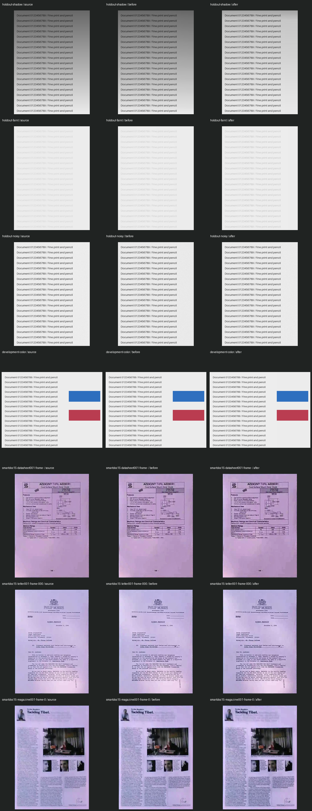

# OpenCV tuning v2 — accepted scope (2026-10-25)

Improve the opt-in OpenCV path in sibling thuvien and compile the same source
for browser comparison. Keep the normal scanner, custom C++ kernels, public API,
crop policy, input/output resolution and native JPEG/PDF quality unchanged.
Keep v2 WASM assets as a frozen baseline; new builds use v3 and distinct result
implementation metadata. Presets remain gentle/balanced/text.

First freeze v1, add failing behavioral tests and construct deterministic ground
truth for shadow/exposure/faint ink/noise/color. Measure real WASM on the existing
licensed samples plus these cases; holdout cases are used after parameter choice.
Do not select settings just by gradient/sharpness metrics. Check background
uniformity, ink contrast, flat-region noise, color shifts and clipping separately.

Evaluate faster luminance processing, bounded illumination estimation on a small
image (never shrink final output), adaptive contrast/detail and noise protection.
OpenCV performs the image operations; domain rules select their parameters.
Retain a change only with useful quality evidence and measured runtime/memory.
No new model, package or full-size float background is required. Cancellation
between operations and the existing explicit resource failures remain mandatory.

Delivery: native regression tests and full CTest, real WASM parity/contracts,
alternating warm/cold baseline/candidate timing, sample contact sheets, full web
checks, browser smoke and public Site update. Document parameter choices and
limits; no universal best/phone thermal/OCR accuracy claim without measurements.

Primary references: OpenCV histogram/CLAHE tutorial (noise amplification and clip
limit), color conversion documentation, image filtering reference (morphology,
Gaussian and border policy). Links and observed results accompany the final report.

## Delivered algorithm and settings

Perspective math/interpolation and all public API signatures are unchanged.
Enhanced uses OpenCV BGR-to-gray luminance, rather than a full Lab roundtrip.
The final RGB delta is bounded to each pixel's available headroom and applied
equally to B/G/R. This native policy loop preserves encoded RGB channel
differences exactly and prevents newly clipped channels. It is deliberately
one fused pass, replacing a measured slower split/merge/arithmetic candidate.
OpenCV still performs resize, morphology, Gaussian, CLAHE and detail extraction;
this is a custom document pipeline using OpenCV, not an untouched stock filter.

| Profile | CLAHE clip | Maximum blend | Dark detail scale |
| --- | ---: | ---: | ---: |
| Nhẹ | 1.4 | .45 | .25 |
| Cân bằng (default) | 2.0 | .70 | .45 |
| Rõ chữ | 2.8 | .85 | .60 |

Tile count follows output dimensions (ceil(side/160), 2–8, capped by pixel size).
Noise is a median absolute residual from a nearest-sampled image no larger than
256px. Blend is multiplied by 1/(1+.3*noise), .45 for color pages and .4 for
periodic texture. Noise >=2 caps CLAHE clip at1.2 and skips sharpening. Near-flat
lightness range<8 and blank noisy range<=40/noise>=3 are preserved. These are
bounded conservative rules, not a learned noise model or calibrated sigma.

On neutral paper with uneven/low illumination, a <=512px luminance map is closed
with a rectangular kernel (odd long-side/32, at least3) then Gaussian-smoothed
(sigma3). OpenCV divide normalizes the final-resolution luminance by this map.
Estimated lift is capped at2x; paper target is220–242. Colored pages, very dark
backgrounds (<45), and low-evidence pages (<90 bright background) skip correction.
The 256/512px images only estimate noise/illumination; final pixels and output
resolution are retained. No AI/model or runtime dependency is added.

Sharpening uses Gaussian sigma.85, dark-only residual, subtracts a 1-level noise
floor, caps detail at12 then scales by the profile. No bright detail halo is
added by this sharpening stage. Illumination/CLAHE can still change paper near
strokes; small (<2-level) synthetic paper variation is visible in raw metrics.
This is neither deblurring nor restoration of lost texture/text.

## Results and tradeoffs

Compared frozen WASM v2 against v3 on this Windows x64 desktop. Parameters were
chosen with seven development fixtures, then checked on seven distinct holdout
fixtures with different dimensions, layout and noise seed. Masks identify paper
and ink before degradation. Baseline/candidate use the same decoded pixels and
crop. No OCR recognition or visual quality score is inferred from gradients.

| Holdout, Balanced | Before | After |
| --- | ---: | ---: |
| Shadowed-paper RMSE against clean paper (8-bit units) | 73.70 | 25.58 |
| Uneven-paper RMSE | 72.27 | 31.87 |
| Underexposed-paper RMSE | 80.16 | 33.59 |
| Faint ink/paper contrast (8-bit units) | 31.34 | 39.71 |
| Noisy-paper standard deviation | 6.04 | 5.73 |
| Crisp-paper mean difference from clean reference | 0 | 1 |

The new method improves these difficult fixtures; already clean pages show little
benefit. Noise protection limits amplification; it does not remove all noise.
RGB-difference preservation is an encoded RGB guarantee, not a perceptual color
calibration or ICC/HDR support. Original limitations on wide-gamut/native codecs
still apply. Color-paper and photographic areas are intentionally conservative.

Also checked the previous four synthetic and15 licensed SmartDoc frames with
identical annotated crops for every profile: no newly clipped enhancement
channels in either version. Contact sheet includes real magazine/photo pages,
paper tint and faint text; real frames have no clean photometric/OCR ground truth.



Warm Node WASM warp+filter+RGBA copies, six alternating runs per version and size,
one warmup per version/size, allocation/decode/PNG/PDF excluded:

| Size | Before median | After median |
| --- | ---: | ---: |
| 960×720 | 38.4ms | 30.3ms |
| 3000×2250 | 372.2ms | 291.4ms |

The 3000px case is about22% faster on this workload. WASM reserved memory was
112.4→104.8MiB after growing through the same preceding fixtures; it is not peak
browser/process RAM. Both instances stay alive in the Node benchmark, but run
sequentially. Local module setup and first raster observations are included in
raw data separately; they do not include a real network download. Native DLL and
physical phone heat/power are not established by this measurement.

Tradeoff: WASM grows from1,493,157 to1,804,535 bytes uncompressed because the new
pipeline adds histogram/morphology/divide/median kernels. It remains lazy-loaded
only for explicit C++ comparison runs. Native20-byte/output-pixel preflight
remains conservative and unchanged. No output downsampling beyond the existing
3000px policy, codec-quality decrease or model download is hidden in these gains.

Raw [synthetic quality/timing](benchmarks/opencv-v2.json),
[previous real-sample observations](benchmarks/opencv-v2-real-before.json),
[new real-sample observations](benchmarks/opencv-v2-real-after.json).

## Verify and reproduce

Native: six CTest suites pass, including failing-before/fixed-after shadow
correction, blank noise, exact RGB differences, no clipping, thin1×3000/3000×1,
identity/skew crop, cancellation, C API and JPEG/PDF integration. Real WASM tests
retain12 custom parity cases and36 OpenCV crop/filter/profile cases. Web527 tests,
lint, TypeScript and production build pass. Physical Android/iPhone remain a
separate test step; no universal best settings are claimed.

Production-preview browser QA: Web/OpenCV and custom C++/OpenCV pairs, all three
profiles, Original, cancellation then restart and JSON implementation metadata
passed. An8064×6048 synthetic PNG produced3000×2250 output and a one-page PDF
parsed independently. This case still reserved392.9MiB WASM (input dominates),
so the smaller-buffer result above must not be read as lower RAM for every input.
See [raw browser observations](benchmarks/opencv-v2-browser-48mp.json).

```text
python scripts/prepare-quality-samples.py
python scripts/prepare-opencv-samples.py
python scripts/prepare-opencv-tuning.py
node scripts/benchmark-opencv-tuning.mjs
```

For real frames, copy `.tmp-opencv/samples` to
`.tmp-opencv-tune/real-before/samples` and `real-after/samples`, then:

```text
node scripts/benchmark-opencv.mjs public/docscan-wasm/v2 .tmp-opencv-tune/real-before
node scripts/benchmark-opencv.mjs public/docscan-wasm/v3 .tmp-opencv-tune/real-after
python scripts/opencv-tuning-contact.py
node scripts/test-docscan-wasm.mjs
```

Test-only Pillow/NumPy are required for generators; no Python dependency enters
the application. Outputs have no user photos. SmartDoc attribution and CC BY4.0
license remain [as documented](benchmarks/opencv-v1.md). Build with the pinned
Emscripten/OpenCV script; v3 build.json records exact source/binary hashes.

Primary references: [CLAHE and noise](https://docs.opencv.org/4.x/d5/daf/tutorial_py_histogram_equalization.html),
[color conversion](https://docs.opencv.org/4.x/de/d25/imgproc_color_conversions.html),
[morphology, Gaussian and border handling](https://docs.opencv.org/4.x/d4/d86/group__imgproc__filter.html).
